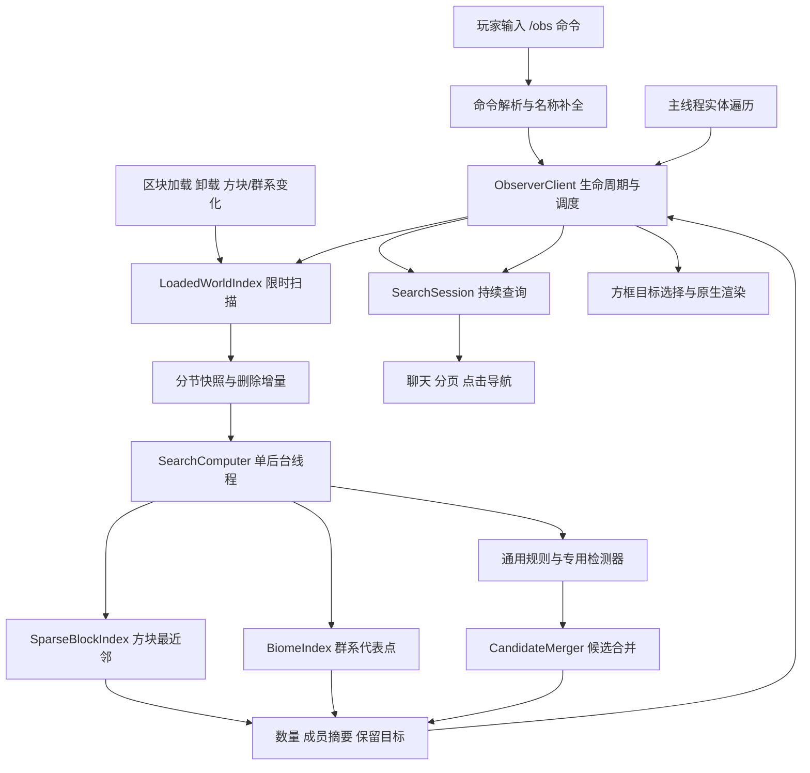
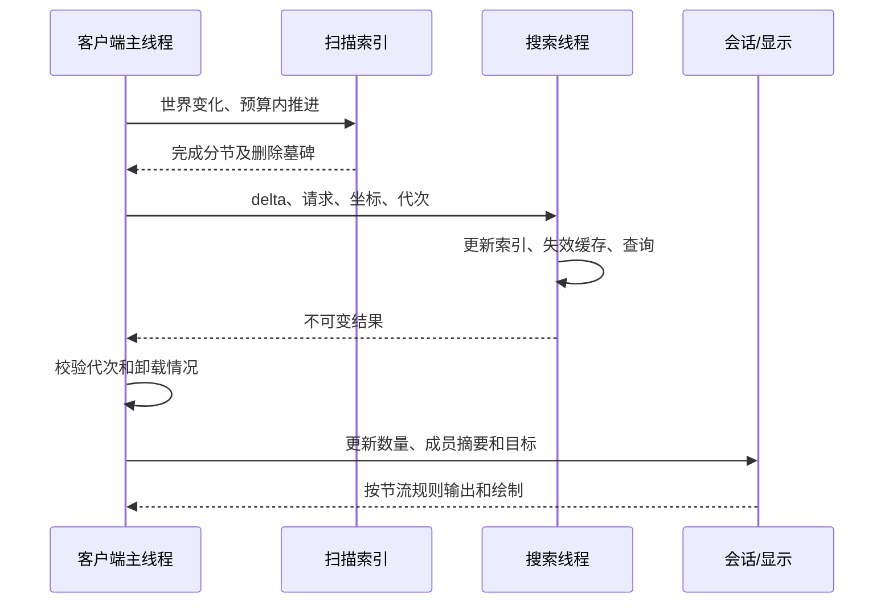
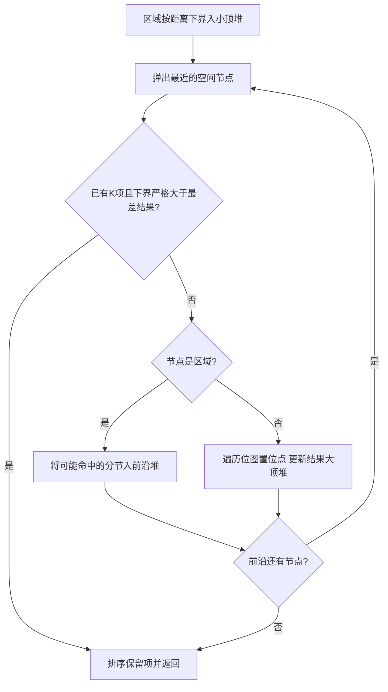

> 26.3 版本补充：新增 18 种废弃营地规则和统一查询，增强远处线框。详见 [26.3 移植说明](docs/PORT-26.3.md)。下文架构与算法继续适用；性能实测数据来自此前 26.2 版本，不能视为 26.3 重测结果。

# Observer：动态体素世界中的增量检索与结构识别

版本：2.1.0；交付日期：2026-10-24。本文对应本文件夹的正式源码与 JAR，面向没有使用过此 Mod 的读者。文中“当前实现”均可在 `src/main/java/dev/observer` 下找到；未来方向不代表已实现功能。

## 1. 背景：这个程序解决什么问题

Minecraft 的世界由三维网格中的方块构成。玩家附近的世界分批加载，远处的区块会卸载，方块和实体也会随时变化。玩家希望问：附近有哪些钻石矿？是否存在废弃矿井？最近的某种生物在哪里？

Observer 将这些需求表达为持续查询。输入 `/obs block diamond_ore` 后，程序不是只找一次，而是随着世界变化维护结果。找到目标后，它在聊天中输出可点击列表，并在世界中绘制方框或实体轮廓。点击结果只调整视角，不传送玩家。

本项目是客户端工具，服务器无需安装。其输入只有客户端已经收到的数据，不包含世界种子、全世界地图、服务器结构生成起点或未知区块。因此它有两种本质不同的输出：

1. **直接检索**：方块和实体按类型匹配；群系按客户端采样数据匹配。
2. **启发式识别**：从材料、环境和局部几何证据推断结构或地物。它不能证明某片建筑一定来自游戏生成器。

例如，发现橡木不等于发现矿井；矿井识别还需要支架、通路和铁轨/蜘蛛网等证据。即使证据满足，玩家仿造也可能产生相同结果。报告中的“准确性”首先指算法正确维护这些既定规则，而不是保证零结构误报。

## 2. 世界与查询的基本概念

| 概念 | 本项目中的含义 |
|---|---|
| 方块状态 BlockState | 不只是方块类型，还包含朝向、含水等属性；方块查询按类型，扫描分类可以区分状态 |
| 区块列 Chunk | 水平 16×16 格、包含多个高度分节的数据单位 |
| 分节 Section | 16×16×16，共 4096 个方块；扫描、快照和增量更新的基本单位 |
| 群系采样 | 每分节 4×4×4 个采样格，每格覆盖 4×4×4 方块尺度 |
| 结构 Structure | 村庄、矿井、沉船等，由证据识别的候选区域 |
| 地物 Feature | 紫晶洞、刷怪房、岩浆池、化石等局部特征 |
| tick | 客户端逻辑更新节拍；不能直接等同于渲染帧 |
| 查询会话 | 一个类别和名称组成的持续请求，拥有 ID、当前结果、报告状态 |
| Target | 统一的结果对象，含身份、导航点、包围盒、解释和近似标记 |

查询类别有 structure、feature、block、entity、biome。相同规范化查询复用会话；不同查询可以共享证据与规则结果。数量上限 K 限制用于展示的最近结果数，不应代替全部匹配数量。

## 3. 总体架构与模块边界

| 模块 | 主要类 | 职责 |
|---|---|---|
| 纯算法层 core | Position、Box、SectionEvidence、各索引和检测器 | 只依赖 Java 标准库，不访问 Minecraft 世界 |
| 扫描适配层 client | LoadedWorldIndex、AnchorDetector | 主线程读取已加载世界，转换为算法可处理的数据 |
| 查询计算层 client | SearchComputer | 单工作线程维护快照、缓存、检测与最近结果 |
| 会话与协调 | ObserverClient、SearchSession | 查询增删、异步任务、代次、结果应用、通知 |
| 交互显示 | ObserverCommands、NameArgument、ObserverText、ObserverChat、ObserverRenderer | 命令、翻译、聊天、导航和绘制 |
| 接入层 mixin | ClientLevelMixin、ClientChunkCacheMixin、MinecraftMixin、ChatComponentMixin | 接入世界变化、实体发光及本地列表日志处理 |
| 配置与观测 | ObserverConfig、ClientMetrics、SearchProfile | 参数边界、主线程阶段统计、按需开启后台 JFR 事件 |

纯算法层独立于游戏 API，便于解释和验证；不是把所有逻辑都写进游戏回调。后台线程只读取已经发布的快照，不读取正在被游戏修改的区块或实体。

## 4. 一次查询完整经历什么

以 `/obs block diamond_ore` 为例：

1. 命令解析并补全命名空间，建立或复用会话。
2. 汇总活动查询需要的材料、方块与群系字段。首次查询将已经接收的区块列加入扫描计划；新增字段使现有分节分批补扫。
3. 每个 tick 在软时间预算和分节数量上限内推进扫描 Job，未完成的 Job 保留游标到下一 tick。
4. 完成分节时生成 SectionData。相对于上次发布，变化分节进入 delta；卸载用对应键的 null 值表示删除。
5. 达到刷新间隔且没有正在执行的任务时，主线程提交请求、坐标、维度、代次和 delta。
6. 后台应用 delta，更新钻石矿位图索引、总数与摘要，选择最近 K 个目标，返回不可变 Answer。
7. 主线程校验任务代次，过滤计算期间卸载的结果，写入会话。
8. 首次完成或成员发生变化时安排聊天报告；更新高亮候选。
9. 玩家继续移动或世界变化，以上过程持续发生。clear 删除会话；断开世界清空全部状态。

结构查询共享前半段流程，但后台改为规则评估、专用几何识别和候选合并。实体查询则直接在主线程从已接收实体构造结果，不经过方块扫描索引。

## 5. 关键数据结构

### 5.1 坐标、区块列与包围盒

[Position](src/main/java/dev/observer/core/Position.java) 保存整数坐标；SectionKey 保存分节坐标。世界坐标按 16 格划分，负坐标也必须按向负无穷取整的分区语义处理，不能直接使用截向零的除法。

[SectionColumns](src/main/java/dev/observer/core/SectionColumns.java) 使用 `Map<Long,List<SectionKey>>`。水平坐标编码为 `((long)x << 32) | (z & 0xffffffffL)`，高低各 32 位分别保存 x、z，避免负数符号扩展破坏另一半。卸载一列时直接取出其分节，不遍历全世界。

[Box](src/main/java/dev/observer/core/Box.java) 是轴对齐包围盒 AABB，最大边界用于表示外边界，单方块框覆盖一格。合并只需对各轴取最小值和最大值，成本为常数。但外接框会包含空白，不能把框内全部空间当作存在结构证据。

### 5.2 稀疏位图

分节内位置编码：`i = (y << 8) | (z << 4) | x`，其中局部 x、y、z 在 0–15。反解为 `x=i&15`、`z=(i>>4)&15`、`y=i>>8`。相邻编码优先沿 X，再沿 Z，最后沿 Y。

BitSet 只用一位表示该位置是否匹配某种材料/查询。4096 位的逻辑存储为 512 字节，实际还包含 Java 对象和 Map 开销。不存在匹配的分节不必进入相应索引，避免为全世界建立密集三维数组。`nextSetBit` 可以跳过未置位区域，不必遍历每个空位置。

群系只需 64 位采样位图；它表达客户端采样格，不代表每个方块都有独立群系值。

### 5.3 分节证据与快照

[SectionEvidence](src/main/java/dev/observer/core/SectionEvidence.java) 保存材料计数、材料包围盒、群系集合、重要方块的锚点列表及可通行位图。普通材料只保留摘要，几何识别需要的细节才保留坐标，降低对象数量。

SectionData 在此基础上附加查询位图、宝藏/刷怪房锚点结果和岩浆源位图。发布后禁止扫描线程继续修改内部对象。Java record 并不会自动冻结内部 Map 或 BitSet，因此这里的安全性依赖所有权转移与必要复制。

delta 是 `Map<SectionKey,SectionData>`，null 明确表示删除，而不是“没有变化”。未知分节也不是空气。保留这些判空处理是数据协议要求，不属于多余防御。

### 5.4 查询状态与结果身份

[SearchSession](src/main/java/dev/observer/client/SearchSession.java) 保存 ID、类别、规范名称、数量、当前目标、完成状态、页号及上次报告摘要。[Target](src/main/java/dev/observer/core/Target.java) 把不同来源统一为可排序、可显示的结果。

身份与位置是不同概念：实体走动仍是同一 UUID；距离排序变化也不意味着发现新目标。结构用代表证据身份，不是服务端结构起点，部分加载造成代表证据改变时可能产生新身份。

## 6. 预算扫描、调色板过滤与连续段聚合

实现：[LoadedWorldIndex](src/main/java/dev/observer/client/LoadedWorldIndex.java)。

### 6.1 为什么必须分批扫描

扫描直接读取游戏世界，必须在主线程进行。一次扫完所有区块会阻塞游戏。Job 保存分节和游标，每 tick 检查软时间截止点，最多完成配置数量的分节；区块列注册也限制每 tick 数量，避免加载回调突然登记大量任务。

这是可续跑的合作式调度，改善响应峰值，但不等于减少总计算量。单次收尾、GC 或操作系统调度仍可能超过预算。

### 6.2 先判断是否值得扫描

分节调色板可回答“是否含有某类状态”。不含任何所需证据时跳过逐格扫描。全空气在必要时批量设置通行位图；均匀分节可以一次建立整段位图和计数。只有需要锚点细节等情况才不能直接使用该快路。

状态到分类结果使用 IdentityHashMap 缓存，避免对每个格子反复查询注册表、处理字符串和判断材料集合。

### 6.3 最终版本的连续相同状态优化

非均匀分节仍按顺序读取每格，但将连续相同 BlockState 组成一段。例如连续 80 格石头，只需一次分类和一次 `BitSet.set(from,to)`，不必执行 80 次分类查找和逐位置写入。

材料计数增加 `to-from`。若段跨 X 行，X 包围范围覆盖 0–15；若跨 Y 层，Z 范围覆盖 0–15；Y 由起止编码得到。`Builder.addRun` 将该段边界合并入材料摘要。锚点仍逐点保留，不能用一个计数替代支架的实际坐标。

每段在 128 格边界截断，维持原有时间检查节奏。设 V 为检查格数、R 为段数：状态读取仍为 O(V)，分类和普通材料摘要更新从逐格降为 O(R)；锚点输出仍与锚点数成正比。这是减少常数和重复操作，不是把扫描复杂度变为 O(1)。高度交错的分节 R 接近 V，收益可能很小甚至出现额外开销。

## 7. 方块最近邻：空间索引、下界剪枝和双堆

实现：[SparseBlockIndex](src/main/java/dev/observer/core/SparseBlockIndex.java)。

### 7.1 两级空间分组

数据结构为“128 格区域 → 16 格分节 → 匹配位置 BitSet”。一个区域每轴包含 8 个分节。它是空间哈希层级，不是 KD-tree，也不是递归八叉树。

最近 K 查询使用两个堆：

- 前沿小顶堆：按玩家到区域/分节的最小可能距离排列，优先检查最有希望的空间。
- 结果大顶堆：最多 K 个点，堆顶是当前保留结果中最差的点，便于快速替换。

### 7.2 距离下界

若玩家某轴坐标处在盒子范围内，该轴最小距离为 0；否则是到最近边界的间隔。三轴间隔平方相加得到距离下界。计算与排序使用平方距离，不必反复开平方；显示距离时才开平方并取整。

当结果堆已有 K 项，且前沿最小下界严格大于当前最差结果距离时，剩余区域都不可能更近，可以结束。用严格大于而非大于等于，是为了继续处理同距离下按位置排序可能更优的点。

### 7.3 自写原始数组堆

NearestBlocks 使用 x、y、z 的 int 数组与距离 double 数组，避免为每个候选分配 Target。插入时向上调整，替换堆顶时向下调整，单次最坏 O(log K)。最终保留点才创建目标对象，依次弹出最大项、倒序存放，得到由近到远的结果。

设 P 为实际访问的匹配点数、F 为展开的空间节点数，成本可粗略写为 O(F log F + P log K + K log K)，另有区域根节点构造成本。空间剪枝可显著减少 P，但最坏可能访问全部匹配点，不能声称查询固定 O(log N)。K 本身很大时，输出和维护成本也不能忽略。

## 8. 通用 Top-K、分页和稳定排序

实现：[Results](src/main/java/dev/observer/core/Results.java)。

实体和绘制候选已经是 Target 集合，不使用方块专用空间索引。N > 4K 时使用有界大顶堆，最后仅排序 K 项；否则直接排序，避免小规模输入上堆维护反而更贵。

全排序约 O(N log N)，堆选择约 O(N log K + K log K)，额外堆空间 O(K)。排序规则是距离、位置、key，处理等距结果时有确定顺序。

分页每页 8 项。前面页只需要选择对应前缀，例如第 3 页只需前 24 项；后面的页需要更长前缀，逐渐接近全排序成本。不能因为只显示 8 行就推断任何页都只计算 8 项。

完整匹配数与成员摘要在截断前计算，所以远处新增目标仍可触发更新；保留列表只负责展示范围。

## 9. 群系索引：每个区块的代表点

实现：[BiomeIndex](src/main/java/dev/observer/core/BiomeIndex.java)。

索引按区块列分组，再按分节保存 64 位采样格。每个匹配列只生成一个目标：遍历其中可能更近的采样格，将玩家坐标夹到采样格对应方块范围，选择最近点。使用分节距离下界跳过不可能改善当前最优值的分节。

因此“找到 20 个 plains”表示 20 个匹配区块，而不是 20 片互不连通的平原。最坏遍历全部匹配采样，输出对象数量则与匹配区块数成正比；这避免给每个采样格创建对象。

## 10. 普通结构：规则、局部证据与 BFS

实现：[Rule](src/main/java/dev/observer/core/Rule.java)、[RuleCatalog](src/main/java/dev/observer/core/RuleCatalog.java)、[Detector](src/main/java/dev/observer/core/Detector.java)。

一条规则声明维度、群系限制、多个材料组及最低数量、用于估计轮廓的材料、聚合尺寸上限和扩展边距。比如紫晶洞用紫水晶、方解石和平滑玄武岩的组合，避免单一材料轻易触发。

评估分节时，先检查自身轮廓证据和环境，再统计其自身及 26 个邻居的材料，使跨分节边界的证据能够组合。负向证据也可以排除候选，例如化石附近的试炼建筑材料。

接受的分节形成隐式邻接图。以稳定坐标顺序选起点，用 ArrayDeque 做 BFS、HashSet 记录访问，逐步合并相邻证据包围盒；尺寸超过规则上限则不继续吸收。输出框扩大规定边距，并选已接收证据中的导航点。

这是带尺寸约束的图聚合，不能简单当作无条件连通分量。邻域固定为 27 格，因此局部评估成本主要由材料组数量和受影响分节数决定；聚合前还有排序，相关更新后也可能重新聚合全部接受候选。

增量检测器维护 accepted、dirty 和上次结果。材料、相关群系或导航点依赖变化才标脏；只重新评估变化邻域。没有相关变化时直接复用结果。**局部证据评估是增量的，不代表全部聚合步骤都严格只处理局部。**

## 11. 专用几何识别

### 11.1 矿井支架图

[MineshaftDetector](src/main/java/dev/observer/core/MineshaftDetector.java) 用 HashSet 保存栅栏、木板与铁轨/蜘蛛网坐标，先识别两侧竖向栅栏及上部木板构成的支架，得到中心和方向。

支架按分节放入空间桶，只在邻近桶中找连接。连接需要满足距离、高度、方向条件，并沿直线或拐角检查两格高的已知可通行证据；缺失分节不视作可通行。随后 BFS 聚合支架，至少两个支架且有铁轨或蜘蛛网线索才输出候选，减少装饰拱门误报。

空间桶减少无关配对，但极密集支架仍可能产生大量比较。原始矿井候选进入下一阶段时只按普通距离合并，不再额外运行一次通道回调，避免重复验证和历史复杂性。

### 11.2 小屋、宝藏、刷怪房

[HutDetector](src/main/java/dev/observer/core/HutDetector.java) 在合适环境中匹配炼药锅和花盆的相对位置。HashSet 加速锚点存在查询，TreeSet 给炼药锅稳定遍历顺序。它依靠家具关系，不要求木屋外壳完好。

[AnchorChecks](src/main/java/dev/observer/core/AnchorChecks.java) 对宝藏检查箱子位置在区块内的特征偏移、下方基础材料和周围覆盖；对刷怪房枚举少量房间半径，检查圆石/苔石地板和墙体比例。搜索半径固定，单锚点成本有固定上界，总成本主要随锚点数增长。客户端适配器只提供已加载方块视图。

这些均为有限规则的启发式验证，不推断箱内物品，也不保证“未被探索”或“天然生成”。

## 12. 岩浆：六邻接连通体与原始队列

实现：[ConnectedFeatures](src/main/java/dev/observer/core/ConnectedFeatures.java)。

将各分节岩浆源位图复制为待访问位图，为分节分配整数 ID，并预计算六个方向相邻分节的 ID。一个体素可编码为 `((long)sectionId << 12) | localIndex`。

从任意未访问体素开始 BFS。入队时清除访问位，防止重复入队；跨边界通过预计算邻居表跳转。队列用 long 数组环形缓冲区，队满时扩容，避免每条邻接边分配 Position 对象。遍历中累计体素数和边界，最终保留满足数量和尺寸条件的小型岩浆源体。

六邻接图 E 与 V 同阶，遍历 O(V+E)=O(V)，此外有分节排序和位图复制。相关证据变化时仍可能重算整个已接收岩浆图；这是潜在优化空间，但本次八查询实测未包含岩浆，不能认定它是当前主瓶颈。

## 13. 候选合并：扫描线与并查集

实现：[CandidateMerger](src/main/java/dev/observer/core/CandidateMerger.java)。

先把原始候选按 X 最小值和 key 排序。扫描当前候选时，活跃列表只保留 X 方向仍可能接近的旧候选，再检查水平距离、垂直距离与类型阈值。村庄容许较大间距，紫晶洞等使用较紧阈值，宝藏等不做这种合并。

并查集 parent 数组维护候选归属，查根时路径压缩；每个根保存当前合成框，超过尺寸上限就拒绝合并。最后为每组选择稳定的原始代表目标，生成合并框。

关键正确性约束：**连接判断只使用原始候选框。** 合并形成 L 形外接框后，框里的空白不应产生新连接边，否则会吸收没有证据关联的对象。

排序 O(N log N)。设 A 为累计活跃比较次数，几何部分为 O(A)；密集重叠时 A 可达 O(N²)。当前并查集只有路径压缩，没有按秩/大小合并，不能直接套用两者兼具时的经典反阿克曼界。尺寸约束也使结果具有策略性，不等同于无约束图的全部连通分量。

## 14. 缓存失效、线程所有权与卸载

实现：[SearchComputer](src/main/java/dev/observer/client/SearchComputer.java)、[ChunkRemovals](src/main/java/dev/observer/core/ChunkRemovals.java)。

后台缓存区分世界快照、方块/群系索引、规则原始结果和查询合并结果。统一查询如 village 依赖多个规则；反向依赖表记录规则影响哪些查询，证据变化时只失效受影响的规则和查询，而不是清空全部结构结果。

矿井和小屋的原始结果只保留一层 rule 缓存，已移除重复的 specialized 缓存。原始结果与查询合并结果语义不同，仍应分别保存。

查询增删或换世界时，generation 使旧任务失效；后台协作检查取消，主线程应用前再次校验代次。区块卸载不不断取消后台任务，而是按列批量删除并过滤返回结果，避免高速移动时任务被反复取消、永远算不完。

同世界重生复用索引；客户端世界对象替换或维度切换时丢弃旧世界数据并保留查询意图重新扫描；断开连接清空全部查询。没有世界扫描查询时释放世界索引，即使还存在实体查询，也无需继续扫描方块。

## 15. 成员摘要、通知、公平调度和显示

[TargetMembership](src/main/java/dev/observer/core/TargetMembership.java) 对稳定身份做 64 位混合哈希并按顺序无关方式聚合。方块索引按分节位图维护摘要和数量，实体使用 UUID。查询比较数量和摘要判断成员是否变化，移动和排序不触发无意义报告。摘要可能碰撞，并非数学上无碰撞的集合相等证明。

每条查询自动报告间隔至少一秒，全局至少 250ms，按查询 ID 轮转，避免某条频繁变化的查询长期占用聊天输出。自动报告的 tick 暂停扫描，降低聊天排版与扫描同时发生的峰值。多行列表合为一个聊天组件，目标行仍有独立点击行为；仅跳过本地高频结果的同步日志写入，不影响普通聊天和错误日志。

点击使用有上限的随机 UUID 令牌映射到当前已识别目标，而不是执行任意坐标。使用时复核会话、加载状态和目标身份；实体同时检查 UUID，避免游戏内部数字 ID 被重用后跳到错误实体。

绘制前跨会话按 Box 去重、选择最近目标。距离外观按视点到盒子表面的距离计算，连续调整透明度和宽度、保持 RGB。ObserverRenderer 缓存 Gizmo 几何，每帧提交原生绘制数据；实体仅提升原版发光判定，不改写服务器发光状态。

## 16. 复杂度总表与算法来源

记 V 为体素数，R 为连续段数，S 为分节数，N 为候选数，K 为保留数。

| 部分 | 主要复杂度/界限 | 实现性质 |
|---|---|---|
| 扫描 | 读取 O(V)，分类/普通摘要 O(R)，锚点逐个输出 | 自行组织预算与批量处理 |
| 方块最近邻 | 剪枝后访问量决定，最坏仍可能全遍历；堆操作 O(log K) | 自写原始数组堆；前沿用 PriorityQueue |
| 普通 Top-K | O(N log K + K log K)，小规模用 O(N log N) 排序 | 标准库堆与排序组合 |
| 群系查询 | 最坏遍历全部匹配采样，输出按区块数 | 自行维护分组位图 |
| 岩浆连通体 | O(V+E)，E=O(V)，另有分节排序 | 自写环形队列与 BFS |
| 候选合并 | O(N log N) 排序，最坏 O(N²) 几何比较 | 扫描线、自写并查集 |
| 列卸载 | 定位分节与列高有关；结果清理另计 | 哈希列索引与批量清理 |
| 缓存失效 | 与变化及依赖有关；部分合并仍可能全量 | 反向依赖与脏集合 |

HashMap、HashSet、TreeSet、BitSet、ArrayDeque、PriorityQueue 和排序来自 Java 标准库；原始数组堆、体素队列、分节空间组织、剪枝流程与并查集合并由本项目实现。哈希访问的常数时间描述通常指均摊情形，不是无条件最坏界。

## 17. 阅读源码的推荐顺序

1. Position、Box、Target、SectionKey：坐标与输出模型。
2. SectionEvidence、SectionColumns、LoadedWorldIndex：输入如何被压缩为证据。
3. SparseBlockIndex、Results、BiomeIndex：检索和最近结果选择。
4. RuleCatalog、Detector、MineshaftDetector、ConnectedFeatures、CandidateMerger：证据如何变成候选。
5. SearchComputer、SearchSession、ObserverClient：增量、线程与持续生命周期。
6. ObserverCommands、ObserverChat、ObserverRenderer 与 mixin：接入与最终体验。

文中 Mermaid 图可在支持 Mermaid 的 Markdown 阅读器中渲染；即使阅读器不支持，图旁的文字和流程列表也完整描述了对应逻辑。
